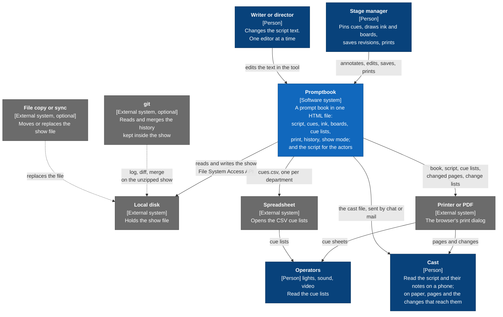
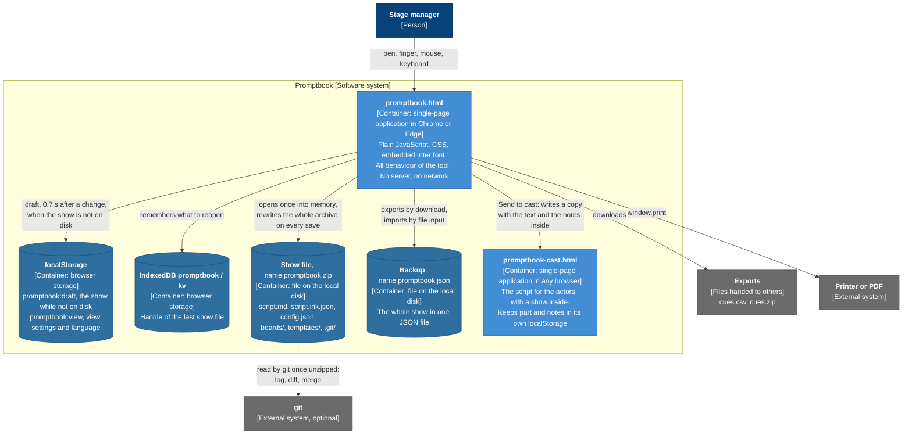
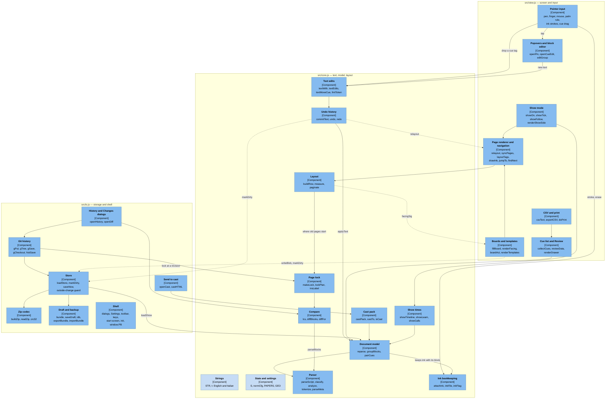
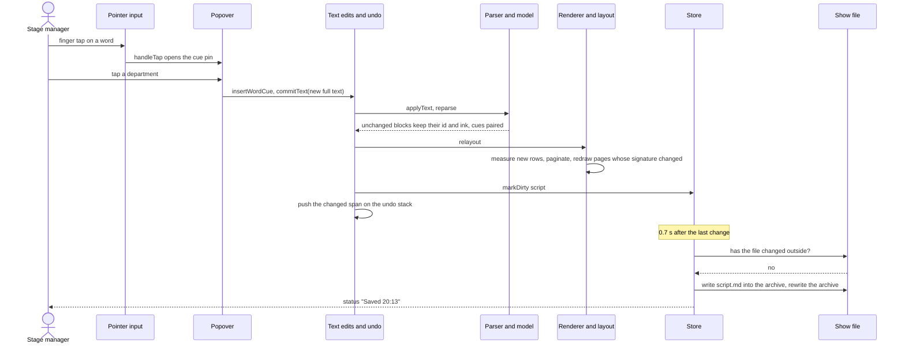
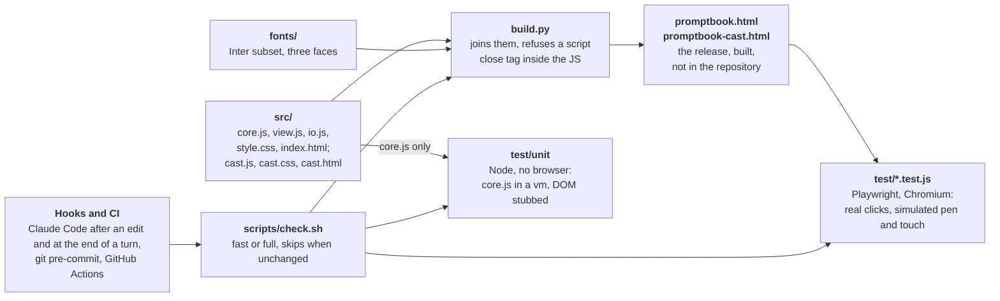

# Promptbook — Architecture

**Describes:** `src/` as built. **Model:** C4, levels 1 to 3, drawn as Mermaid flowcharts.
**Companion files:** `SPEC.md` (why and what), `docs/verification.md` (what the checks cover).

How to read the diagrams: a box is a person, a software system, a container (something that runs or stores data on its own) or a component (a part inside one container). The second line of a box, in square brackets, says which. An arrow points from the part that acts to the part acted on, and its label says what for; where a label is passive ("read by"), read it that way round. A dashed arrow is either an optional outside tool (levels 1 and 2) or a call that goes against the intended layering (level 3).

---

## 1. Intent

The architecture exists to satisfy five product constraints (`SPEC.md` §2.1):

| Constraint | What it forces |
|---|---|
| C1 one HTML file, no install, no server, no libraries | Everything is one single-page application; the script for the actors is a second file built from the same sources. Zip, git objects, CSV and the IndexedDB wrapper are written by hand. |
| C2 no network | No back end, no telemetry, no CDN. The font is embedded. All data stays in the browser or in files the user picks. |
| C3 Chrome or Edge on a pen-and-touch laptop | The File System Access API is the storage path; pointer events tell pen, finger and mouse apart. |
| C4 one editor at a time | No merge, no locking protocol, no sync. A changed file on disk is detected and the user is asked. |
| C6 a show is plain files | The script is the source of truth and holds the cues. Everything else is keyed to its text. |

## 2. Level 1 — System context



| Element | Role | Source |
|---|---|---|
| Stage manager | The one user for whom the tool is built and tested. | D13, D15 |
| Writer or director | Changes the text in the tool. Never at the same time as the stage manager. | D2, D15 |
| Operators | Do not use the tool. They receive paper and CSV. | D9 |
| Cast | Read the script for the actors, a file of their own that never edits the script; receive paper. | CST, HIS-9 |
| Local disk | The only place a show is kept besides the browser's own storage. | D10 |
| git | Optional. The tool writes a repository git can read; it never calls git. | HIS-1 |
| File copy or sync | Not a feature: a fact of life. A replaced show file is detected (STO-11). | D15 |

There is no arrow to any network host. That absence is a requirement (C2), not an omission: the cast file travels by whatever means the company already uses, outside the tool.

## 3. Level 2 — Containers



| Container | Technology | Holds | Written when | Spec |
|---|---|---|---|---|
| `promptbook.html` | HTML, CSS, JavaScript in one file of about 570 KB, of which about 110 KB is the font and about 140 KB the actors' file, carried as a string | Nothing durable. All state is in memory in one object, `S`. | — | all |
| Show file | Zip (store or deflate), written by `buildZip` | The show and its history | 0.7 s after the last change; the whole archive each time | STO-1, STO-2 |
| `localStorage` | Two keys | The draft of a show not on disk; view settings | Draft: 0.7 s after a change. Settings: on toggle | STO-8, UI-8 |
| IndexedDB | One store, one key `dir` | A file handle | After every open and "Save as show file…" | STO-7 |
| Backup | JSON, `format: "promptbook"` | Script, ink, settings, boards and templates with images as data URLs | On request | STO-8 |
| Exports | CSV with BOM; zip of CSVs | Cue lists | On request | CUE-38, CUE-39 |
| `promptbook-cast.html` | `core.js` and `cast.js` in one file, system fonts; its own `localStorage` keys | The text and the notes sent, inside the file; on the device, the actor's part, read marks and own notes | When "Send to cast…" is used | CST |

Two storage modes follow from these containers. `S.store.mode` is `zip` or `memory`: in `zip` the show's files are a map in memory (`S.store.files`) written out as one archive; in `memory` the show is saved as the draft.

## 4. Level 3 — Components of `promptbook.html`

`promptbook-cast.html` is not drawn: it is `core.js` (strings, helpers, parser) joined with `cast.js`, whose sections are the show (`usePack`, `anchorOwn`), the text, the sheets and the files (`docs/specs/10-cast.md` §3).

The application is three source files concatenated into one `<script>` in the order `core.js`, `view.js`, `io.js`. They share one scope: there are no modules. A component below is a section of a file, marked in the source with `/* ---------- name ---------- */` or a `=====` banner.



Reading note: the layout engine draws one arrow behind a box. The dashed `facingSig` arrow runs from Layout to Boards and templates; it only passes behind Cue list and Review on the way.

Three components have no arrows, to keep the picture readable. `Strings` and `State and settings` are used by every component: `t()` is called about 300 times and `S` is read or written about 650 times across the three files. `Shell` wires up all the others: it binds the toolbar, the menu and the keyboard to their functions and calls `init`.

| Component | File, section | Responsibility | Serves |
|---|---|---|---|
| Strings | `core.js`, strings | Every user-facing text, in English and Italian, read with `t('key')` | UI-5 |
| State and settings | `core.js`, constants, state | The one mutable state object `S`; defaults and clean-up of `config.json`; page geometry | all |
| Parser | `core.js`, PARSE | Text to blocks (`h`, `speech`, `action`, `para`, `mark`, `note`, `meta`), words and cue tokens. Pure. | TXT |
| Document model | `core.js`, `reparse`, `pairCues` | Replaces the text while keeping each unchanged block's identity; pairs ends with cues; assigns rail lanes | TXT, CUE-9, INK-5 |
| Text edits | `core.js`, `textWith` … `textMoveCue`, `textMoveBlocks` | Every change to the show's text is computed as a new full text | CUE, TXT-31, BRD-5 |
| Undo history | `core.js`, history | `commitText` applies a text and records the changed span; a stack of `{undo, redo}` closures, 200 deep | TXT-5 |
| Ink bookkeeping | `core.js`, ink bookkeeping | Which ink belongs to which block, the "check" flag, orphaned ink, the ink file | INK |
| Compare | `core.js`, compare | Longest common run of blocks and of words; what a change means for one character | HIS-8, HIS-9 |
| Cast pack | `core.js`, cast | The text without tokens and the notes for the actors, as one object | CST-2, CST-5, CST-6 |
| Show times | `core.js`, show | The time of every block, the place of the line, what a mark teaches, which cues are to be called | SHW-5, SHW-6, SHW-12 to SHW-24 |
| Page lock | `core.js`, locked page numbers | Records where blocks were; plans where pages must start; names inserted pages | PAG-13 to PAG-19 |
| Layout | `core.js`, LAYOUT | Builds a row's DOM, measures it in a hidden element, breaks blocks into pages | PAG |
| Page renderer and navigation | `view.js`, VIEW, navigation | Draws only the pages near the screen; margin tags, connector lines, rails, ink; jump and find | PAG-10, CUE-7, UI-2 |
| Boards and templates | `view.js`, facing page, templates | Facing page, board figures, grid, template chains, Templates view, images | BRD |
| Show mode | `view.js`, show | Read only and focus; the running line, the page in steps, the rail of calls, the map | SHW |
| Pointer input | `view.js`, INPUT, drag | One state machine for pen, finger and mouse: draw, erase, tap, scroll, long press, drag a cue or a block | INP, CUE-25 to CUE-34, CUE-43, TXT-28 to TXT-30 |
| Popovers and block editor | `view.js`, POPOVERS, in-place editor | Cue pin, cue editor, board name, comment, ink flag; the text editor of a block | CUE-3, TXT-8 |
| Cue list and Review | `view.js`, PANELS | Rows computed from the tokens; the Review sections and the badge | CUE-35, UI-1 |
| CSV and print | `view.js`, end of PANELS | CSV text, downloads, print modes | CUE-38, PAG-11 |
| Store | `io.js`, STORE | The two storage modes behind `readFile` / `writeBlob`; dirty flags; autosave; outside-change guard; opening a show; parts that cannot be read; the release mark | STO |
| Zip codec | `io.js`, zip | Reads and writes zip archives with the browser's deflate; checks every entry against its CRC | STO-1, STO-23 to STO-25 |
| Draft and backup | `io.js`, `bundle` … `importBundle`, `idb` | The show as one JSON object; draft in `localStorage`; last handle in IndexedDB | STO-7, STO-8 |
| Git history | `io.js`, HISTORY | Loose objects, trees, commits, refs; commit, checkout, revision, variant, restore; objects used only when whole | HIS-1 to HIS-6, HIS-13 to HIS-15 |
| History and Changes dialogs | `io.js`, `openHistory`, `openDiff` | The two dialogs over the git history and the comparison | HIS-7, HIS-10 |
| Send to cast | `io.js`, cast | The dialog, and the actors' file written with the show inside | CST-4 |
| Shell | `io.js`, DIALOGS, TOOLBAR | Dialog frame, Settings, menu, toolbar and corner dock, keyboard (`KEYS`, `KEYMAP`, `openKeys`), paste, start screen, sample, `init`, and `window.PB` for the tests | UI |

## 5. How a change travels

One path carries every change to the script text: a pinned cue, an edited block, a moved tag, a renamed board. Ink and board strokes skip the parser and go straight to the store.



Three properties of this path are the centre of the design:

1. **The text is replaced whole.** No component edits a block object in place. `reparse` then finds what stayed the same by comparing the unchanged run at the start and at the end, and matches the middle by text and similarity. That is how ink survives edits (INK-5) and why a cue has no id of its own: it is found again by block id and offset.
2. **A page is redrawn only when its signature changes.** `paginate` gives every page a string made of its blocks, fragments, head and rails; `syncPages` compares it with what is on screen.
3. **Saving is by dirty flag and timer.** `markDirty` sets a flag and restarts a 0.7 s timer; `saveNow` writes what is flagged and, in a show file, rewrites the archive.

## 6. Data

The show is a set of files inside the show file. Shapes are specified in `docs/specs/07-storage.md`.

```
name.promptbook.zip
  script.md              the script, with cue and board tokens      source of truth
  script.ink.json        ink strokes, keyed to block text
  config.json            title, paper, departments, templates, grid, page lock,
                         show-mode times, release mark
  boards/<slug>.json     one drawing per board, plus its image file
  templates/<slug>.json  one drawing per template, plus its image file
  damaged/               parts that could not be read, kept as found
  .git/                  loose objects, refs, HEAD: revisions and variants
```

Derived and never stored: blocks, cue pairs, pages, page numbers, the cue list, the Review lists, the comparison of two revisions, the calls of show mode.

## 7. Build and verification



The unit checks read `src/core.js`; the browser checks read the two built files. A browser result means nothing until the build has run after the last change to `src/`. `build.py` writes `promptbook-cast.html` first, then `promptbook.html` with that file inside it as the string `CAST_APP`. GitHub Actions runs the build and every check on each pull request and push to `main` (`.github/workflows/ci.yml`); a tag `rX.Y` publishes the two files as a GitHub release and on GitHub Pages (`release.yml`). Current numbers are in `docs/verification.md`.

## 8. Consequences

What the architecture buys, and what it costs.

| Consequence | Detail |
|---|---|
| One file to hand over | Copy `promptbook.html` and a show file to any machine with Chrome or Edge. Every release on GitHub carries the file. |
| No back end to fail in rehearsal | Nothing to start, nothing to log into, nothing that needs the theatre's network. |
| Hand-written infrastructure | Zip, git objects, IndexedDB and CSV, a few hundred lines in all. Each covers only what the tool needs: no zip64, no encrypted entries, no packed git objects, no git index. |
| One scope, no modules | Any function can call any other. The layers (parse, layout, interact, store) are conventions, not boundaries: `core.js` calls up into `view.js` and `io.js` (`relayout`, `facingSig`, `closePop`, `markDirty`, `updUndo`) and `view.js` calls up into `io.js` (`markDirty`, `writeBlob`, `readFile`, `onDisk`, `buildZip`, `saveError`). The unit checks have to stub four of these to load `core.js`. |
| Layout needs a browser | Line breaks are measured in the DOM, so pagination, page locks and ink position cannot be checked without Chromium. |
| Whole-archive saves | A show file is rewritten in full on every save, history included. Simple and atomic; the cost grows with the history (`docs/specs/08-history.md` §3). |
| One state object | `S` is the only state. Easy to inspect and to export for the tests; nothing prevents any code from changing any part of it. |
| Device-bound input | The pointer state machine is the least testable code and the part most dependent on real hardware (`docs/verification.md` §4). |
