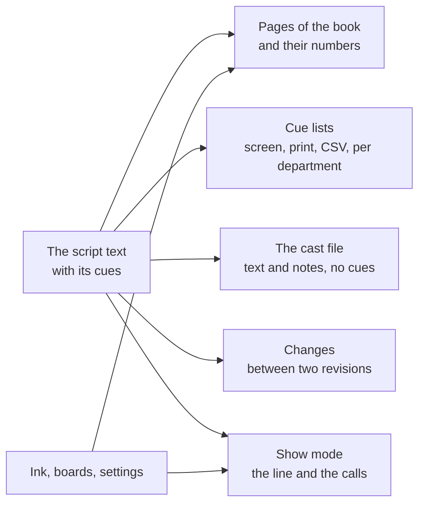

# One text, many readers

*Why the script is the only thing you keep, and everything else is made from it.*

## The problem this answers

In most productions the script exists several times over. The author has a Word file. The stage manager has a printed copy with cues in pencil. The lighting operator has a sheet typed from that pencil. The actors have photocopies, some from last month. Each copy is correct on the day it is made and wrong a little more every day after, and nobody can say which is the show.

The copies drift because each is kept by hand. Promptbook's answer is to keep one thing by hand and make the rest.

## What is kept

A show is a plain text, written the way a script is written:

```
# ACT ONE
## Scene 1

(Dark. The sea is heard.)

ANNA: Who is there? {LX 12 | blackout} Answer me!
MARCO: It is me.
```

Acts, scenes, speeches and actions are recognised from how the lines look. A cue is a short mark in braces, sitting after the word it is called on. You do not type it: you tap the word and choose a department. But it is *in the text*, and that is the point. When the speech is moved to another scene, the cue goes with it. When a sentence is cut in front of it, the cue is still on its word. When the tool is not there at all, the file can still be read, by a person or by any editor.

Around the text a show keeps three more things, each for something text cannot hold:

- **Ink**: what the pen wrote on the pages. It is tied to the speech it was written on, not to a place on a page.
- **Boards**: drawings and plans on the facing page, with the templates they are drawn on.
- **Settings**: the departments and their colours, the paper, the locked page numbers, the times learned in rehearsal.

These four, together, are the show file: one `.zip`. Once the show has a history, the history is in it too.

## What is made

Everything else is worked out from those, every time it is looked at, and stored nowhere:



- **The pages.** Where a page breaks, and so its number, is computed from the text and the paper size. Page numbers are never used to remember anything, which is why adding a speech on page 3 cannot lose a cue on page 40.
- **The cue lists.** One row per cue, read from the text each time the list is opened. There is no list to keep in step with the book, because the list *is* the book, filtered.
- **The cast file.** The same text with the cues taken out and your notes for the actors left in.
- **The changes** between two revisions, and what of them reaches each character.
- **The calls in show mode.** Warning, standby and go come from where the cues sit in the text and from how long the text before them takes.

A thing that is made cannot be out of date. That is the whole design.

## What follows for the stage manager

**The book is the master from the day the first cue goes in.** Before that, the author's file is the script. After that, the script inside the show is, because it is the only copy that has the cues. This changes how rewrites arrive: they come *into* the show, they do not replace it. See [Take in a rewrite](../how-to/04-take-in-a-rewrite.md).

**Never correct a made thing.** A wrong number on a cue sheet is corrected on the cue in the book, and the sheet is printed again. A wrong word in the cast file is corrected in the script, and the file is sent again. If you fix the copy, the next copy is wrong again.

**The tool reports, it does not refuse.** A text pasted from Word is never perfectly formed. A line the tool cannot place is kept exactly as written and listed under **Review**; a cue number used twice is marked in the cue list; a name that is not in the character list is shown with a count. Nothing is blocked and nothing is dropped. The other side of that bargain is yours: open Review before you print.

## What follows for the author

**Your words are stored as you wrote them.** The tool reads the text to lay it out; it does not rewrite it. A script that goes in and comes out with no edit is the same text, to the letter.

**The braces are not yours, and they are small.** After the stage manager has worked on it, the text carries marks such as `{LX 12 | blackout}`. They sit after a word and say nothing to an actor. If you edit the text that has them, leave them where they are and move them with their word.

**The format is the one you already use.** `NAME: text`, a line in brackets for an action, `#` for an act. The top of the file can carry title, author and the list of characters. The exact forms are in the [Reference](../reference.md).

## What it does not do

One person edits at a time. There is no shared document that two people type into: the show is a file, and whoever has the file has the show. An author and a stage manager who both change the text on the same day must put the two together by hand (or with git, for those who use it).

The text and its cues are plain and durable. The ink and the boards are not text; they are kept as well as the tool can keep them and they are the first thing to check after a large rewrite. Why, and how they follow the text, is in [What survives a rewrite](02-what-survives-a-rewrite.md).
