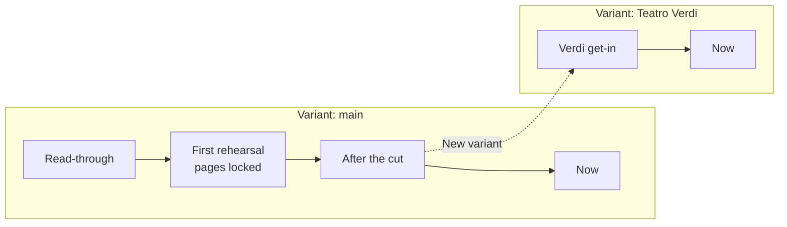

# Revisions, variants and locked pages

*Three answers to the question "which version is this?"*

"Which version?" is really three questions, asked by different people.

- The director asks: *can we go back to how it was on Tuesday?* That is a question about **time**.
- The producer asks: *is this the cut for the festival or the full one?* That is a question about **occasion**.
- The actor asks: *is my page 14 still page 14?* That is a question about **paper**.

Promptbook has one tool for each: a revision, a variant, a lock. They are kept apart on purpose, because mixing them is what makes versions unmanageable.

## A revision is a named moment of the whole show

Every change you make is saved as you go. That protects against losing work; it does not give you anything to go back *to*. A revision does: it is the show as it is at the instant you press **Save revision**, under a name you give it, such as "Rehearsal 12 October" or "Before the Act Two cut".

Two things about it matter.

**It is saved only when you say so.** The tool does not make a revision every evening. A revision marks a moment that means something to the company, and only you know which those are. A useful habit: one at the end of each rehearsal, one before any large change, one whenever paper is handed out.

**It is the whole show.** Text, cues, ink, boards, templates, settings. When you **Restore** a revision, all of it comes back together: the cues as they were numbered then, the blocking as it was drawn then. There is no way to bring back only the old text and keep today's ink, because ink written on today's words would have nothing to sit on.

Restoring loses nothing either. Before the show goes back, the show as it is now is saved by itself as a revision called "Before going to …". You can always return from a return.

## A variant is the show as given somewhere else

A tour plays a theatre with a smaller rig. A competition wants forty minutes, not seventy. A school performance drops a scene. Each is the same show and not the same text, and each will go on changing on its own.

A variant is that: a line of the show with revisions of its own. **New variant** starts one from the show as it stands; from then on you choose which variant you are working in, and a change made in one does not reach the others.

That last sentence is the cost. If the author corrects a line that every variant has, the correction is made once in each. The tool does not merge. It was a choice: merging text that also carries cues, ink and locked pages can go wrong in ways a stage manager should not have to untangle on a show day. So:

- Make a variant **late**, when the main text has settled.
- Make one only for a difference that will **stay**. A cut you are trying for a week is a revision, not a variant: save one before, try the cut, restore if it does not work.

## A lock is the paper

Page numbers are computed from the text, so they move when the text does. On a screen that is fine. Once pages are printed and the cast has written on them, it is not: "take it from the top of 23" must mean the same sheet for everyone.

Locking page numbers records where every speech was at that moment. From then on:

- A page **starts where it started** on paper, whatever was added before it.
- Text that no longer fits goes to an **inserted page**: 12A, 12B, between 12 and 13.
- A page left empty by a cut is **dropped**, and its number is never used again.
- A page whose words, or whose breaks, differ from the paper is **marked**: "∗ changed since …" at its foot.

The marks are the point. They are the list of sheets that are wrong in people's hands. **Print changed pages** prints those and no others, and the cast swaps them in.

Only words mark a page. Adding or moving a cue does not: the actors' pages do not show cues, and nobody should reprint for a lighting change.

You lock by ticking **Lock page numbers here** when saving a revision, so a lock always names the moment it was made. Lock again at a later revision and that one becomes the paper; inserted pages keep their letters. **Unlock** goes back to plain numbers.

## How the three fit

- A **revision** is a point on a line.
- A **variant** is a line.
- A **lock** is a flag on one point, saying "this is what was printed". It belongs to its variant: the tour has its own paper.

And two things that are made from them:

- **Changes** compares any two revisions, or one with the show now. It is the list of what the author did between two rehearsals, and, narrowed to one character, the sheet you give that actor. See [Tell each actor what changed](../how-to/07-tell-actors-what-changed.md).
- **The cast file** is the text of the show at the moment you make it. It does not know about revisions; saving one each time you send a file is how you remember what the cast has. See [The script in the actors' hands](04-the-cast-script.md).

## Which to use

| You want to | Use |
|---|---|
| Be able to undo tonight's rehearsal changes | A revision, saved before |
| Try a cut and maybe keep it | A revision before; restore if not |
| Keep a shorter version for a festival, alongside the full one | A variant |
| Hand out pages and keep their numbers | A revision with the lock ticked |
| Replace only the sheets that are wrong | The lock, then "Print changed pages" |
| Tell Anna what changed in her part | Changes, shown for ANNA |

## What it rests on, and its limits

The history is a real git repository inside the show file. That is not something you need to know to use it; it means that nothing was invented, that the history travels with the file, and that someone who uses git can unzip a show and read it with git's own tools.

It also sets the limits:

- **History needs a show file.** A show kept only in the browser has none. Use "Save as show file…" first.
- **The file grows.** Each revision keeps a copy of what changed since the last, and the ink changes with every stroke. Nothing is ever thrown out.
- **A revision cannot be renamed or deleted**, nor a variant, in the tool.
- **There is no looking at an old revision without going to it.** To read Tuesday's text you restore Tuesday (today is kept) and come back.
- **Who saved a revision is not recorded.** The show has one editor; the history says when, not who.
