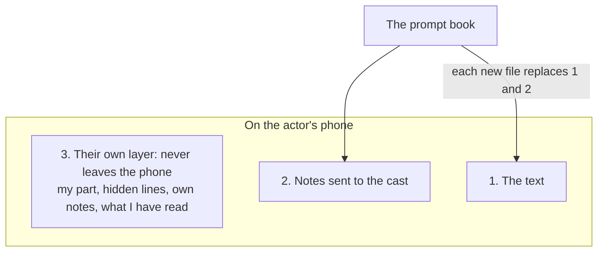

# The script in the actors' hands

*What leaves the prompt book, what never does, and what stays on a phone.*

## Two files, on purpose

The prompt book is a working desk: cues, ink, blocking, history, a pen. An actor needs none of that. They need their words, the notes meant for them, and a way to learn lines on the bus.

So the cast gets a different tool: a small reader, `promptbook-cast.html`, that opens on a phone and cannot change the script. "Send to cast…" writes a copy of that reader with your show inside it. One file, sent however the company already sends things. Nobody installs anything and nothing goes through a server.

## Three layers

What an actor sees is three things laid over each other, and it helps to keep them apart, because each has a different owner.

1. **The text.** The script with every cue, comment and to-do note taken out. The title page and the characters stay.
2. **The notes you sent.** Each belongs to a line and says who wrote it and who it is for.
3. **The actor's own layer.** Which characters are theirs, whether their lines are covered, the notes they typed themselves, which of your notes they have read.

Layers 1 and 2 are yours. Every file you send replaces both, whole. Layer 3 is theirs. It lives on their device, is never in your file, and never comes back to you.

That split is what makes sending a new file safe. You are not overwriting anybody's work, because their work was never in what you sent.

## What never leaves the prompt book

Cues, to-do notes, comments, ink, boards, the history, the times of show mode. A cast file cannot leak the lighting plot, and making one changes nothing in the show.

## Notes for the cast are cues of a special department

There is no separate notes system to learn. In Settings a department can be ticked **Cast**. A note pinned under it is written exactly like a cue, on a word, with a margin text. The department's name is who is speaking: call it "Director" and the actor reads "Director: slower here".

Such a note is for **whoever speaks the line**, unless you say otherwise. On a line nobody speaks (an action, a scene heading) it is for everyone. You can name others, or everyone, in the box of the note.

Two consequences:

- A note belongs to its **whole line**, not to the word you pinned it on. The actor sees it beside the speech.
- These notes are listed under **Review**, as "Notes for the cast", and never in the cue list. Operators do not get acting notes.

## When a new file arrives

This is the part that had to be thought about. The text changed; the actor has notes on the old text; what happens?

The reader knows a file belongs to the same show (by an identity the prompt book gives the show, not by its title, so a renamed show is still the same show) and that it is newer. Then:

- **Their own note on a line that did not change** stays on that line.
- **On a line that changed**, it goes to the most similar line of the same speaker and is marked, until the actor confirms it there.
- **On a line that was cut**, it leaves the page but is not deleted: it is kept under Notes with the words it was written on, and can be put on another line.
- **Your note, unchanged**, stays read if it was read. A note you reworded is new again.
- **Lines that differ** from the file before are marked at the edge.

The file opens on **What is new**: notes to read, how many lines changed and how many of them are theirs, which of their own notes need a look. An actor who opens the new file knows in ten seconds whether anything concerns them.

An **older** file opened by mistake does not undo any of this: the reader says it is older and leaves the actor's layer alone.

## My part, and learning lines

**My part** lists every speaker name exactly as the script writes it, a box beside each. An actor ticks the names they speak under. `ANNA AND MARCO`, `ALL`, `CHORUS` are names like the others: the tool does not guess who is in a group, the actor ticks the groups they belong to. That is deliberate. Who sings in the chorus is known to the cast, changes with the casting, and is not written in the script.

**Hide my lines** covers the text under the ticked names and leaves the name, so the cue line before is readable and one's own is not. A tap shows a line; another covers it again.

Once a part is ticked, the notes shown are those for that part and those for everyone.

## What this cannot do

Better known now than at the dress rehearsal:

- **Notes go one way.** An actor cannot answer through the file, and you cannot see what was read.
- **One file goes to everyone.** A note for Anna is inside the file Marco gets; he does not see it under "For me", and can under "All". Do not put in a cast note what only one person should read.
- **A sent note is not taken back.** The next file simply does not have it.
- **The actor's layer is in one browser on one device.** A new phone, another browser, or a mail app that opens each attachment in a sealed viewer, and the file opens with no part and no notes. **Export my notes** on the old device and opening that export on the new one carries them over, by hand.
- **Changed lines are found by comparing whole lines.** A comma is a change. A speech moved to another place, unchanged, is not.
- **Not yet tried on real phones.** It was checked in a simulated browser at phone width. Opening an `.html` attachment from a chat or mail app on Android and iOS has not been tried; some of them may show the file as text or without storage. Try it with one actor before sending it to twenty.

## Paper is still there

The cast file does not replace printed pages for a company that works on paper; it runs beside them. Paper has its own way of staying current: locked page numbers and "Print changed pages" ([Revisions, variants and locked pages](03-revisions-variants-locks.md)). Many companies will use both: sheets for the rehearsal room, the phone for learning lines and reading notes.
