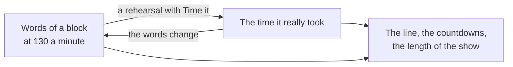

# A clock, not an ear

*What show mode knows about the show, and what it has to be told.*

## What it is for

On a show night the book has one job: tell the stage manager what is coming, early enough to say "stand by". On paper that is done by reading ahead with a finger on the line. Show mode does the reading ahead: a line runs down the script, and the cues it will reach are called, **WARNING** two minutes out, **STANDBY** thirty seconds out, **GO** as it passes.

It also makes the book safe. In show mode nothing can be changed: the pen draws nothing, a tap pins nothing, no key edits. A sleeve on the screen during Act Two cannot move a cue.

## What it does not know

The tool does not hear the stage. It has no microphone and follows no voice. The line is a clock running over the text: it knows how long each speech *should* take and moves accordingly. When an actor pauses, drops a page or takes a laugh, the line does not know.

So the line is right on average and wrong in detail, and the person holding the book corrects it. A double tap on a word says "the show is here"; the line goes there. This is not a flaw to work around, it is how the thing is meant to be used: the tool keeps count, you keep it honest. Calls are still yours to give. The countdown tells you when to breathe in.

## Where the times come from

Every block of the script (a speech, an action) has a time.

To begin with it is a guess: its number of words at 130 words a minute, with a little added for an action, since "they fight" is two words and two minutes. A guess of that kind is good enough to get warnings roughly right and not good enough to trust.

Rehearsal makes it better. With **Time it** switched on, each time you double tap to say "the show is here" while the line runs, the real time since your last mark is kept and shared among the blocks in between. Mark often and each speech gets its own time; mark once a page and the page's time is spread across its speeches. A silent sequence can be set by hand, five seconds at a time.

After one timed run the line follows the show closely, and the countdown to a cue means something.

Three things keep this from going wrong:

- **Time it is off every time you enter show mode.** A show night never changes the times by accident.
- **A time belongs to the words.** Rewrite a speech and its time is forgotten; it goes back to the guess until it is timed again. A rewritten scene does not carry a stale time.
- **Nonsense is not learned.** A mark made while the line is stopped, a jump backwards, a chunk impossibly fast or slow: these move the line and are not kept as times.

## The pace of the night

Some nights run fast. The audience is cold, or the lead has a train to catch. The times are not wrong; tonight is.

So there is a second, smaller control: the pace of the night. − and + make the line run a little slower or faster than the times say, for this run only. It is back at 100% the next time you enter show mode. If you correct the line for a minute, the panel offers the pace your corrections add up to, and one press takes it.

Keep the two apart in your head. *Time it* teaches the book how long the show is. *The pace of the night* tells it how this performance is going.

## Why the page stands still

A page that creeps upward under your eyes is hard to read and impossible to find your place on after a glance at the stage. So the page does not scroll with the line. It stands still while the line goes down it, and when the line is two thirds of the way down, the page jumps by a third.

You can scroll away at any time to look at something else, or press a call to see where its cue is. The line keeps running where it was. **Back to the line** returns.

## What else the clock gives

Because every block has a time, the whole show has one: how far in you are, how long is left at tonight's pace, and what time it will come down. A map down the edge shows the scenes at their real lengths, with a tick for every cue. Before the timing is done these are estimates, and say so.

## How far to trust it

Plainly: this has been checked in a simulated browser, and has not yet been through a real rehearsal with a real company. Whether 130 words a minute is a sensible start for your actors, and how the timing feels with a pen in the other hand, is not known.

Until it has run a rehearsal or two for you:

- Use it in rehearsal first, with paper beside it.
- Treat the countdowns as a prompt to look, not as the call.
- Trust the read-only part completely. That part is simple, and it holds.

How to do the two jobs: [Time the show in rehearsal](../how-to/10-time-the-show.md) and [Call a show](../how-to/11-call-a-show.md).
