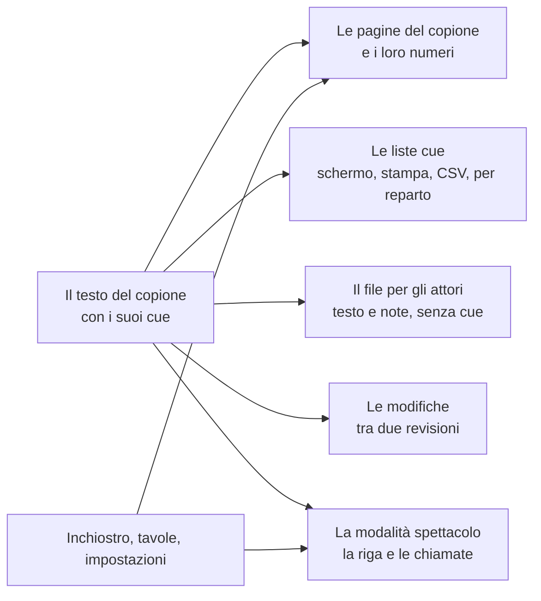

# Un testo, molti lettori

*Perché il copione è l'unica cosa che tieni, e tutto il resto ne viene ricavato.*

## Il problema a cui risponde

In quasi tutte le produzioni il copione esiste più volte. L'autore ha un file di Word. Il direttore di scena ha una copia stampata con i cue a matita. L'operatore luci ha un foglio battuto a partire da quella matita. Gli attori hanno fotocopie, alcune del mese scorso. Ogni copia è giusta il giorno in cui viene fatta e un po' più sbagliata ogni giorno che passa, e nessuno sa dire quale sia lo spettacolo.

Le copie divergono perché ognuna è tenuta a mano. La risposta di Promptbook è tenere a mano una cosa sola e ricavare le altre.

## Che cosa si tiene

Uno spettacolo è un testo semplice, scritto come si scrive un copione:

```
# ATTO PRIMO
## Scena 1

(Buio. Si sente il mare.)

ANNA: Chi è là? {LX 12 | buio} Rispondi!
MARCO: Sono io.
```

Atti, scene, battute e azioni si riconoscono da come sono fatte le righe. Un cue è un piccolo segno tra parentesi graffe, messo dopo la parola su cui viene chiamato. Non lo scrivi tu: tocchi la parola e scegli un reparto. Ma è *dentro il testo*, ed è questo il punto. Quando la battuta viene spostata in un'altra scena, il cue va con lei. Quando davanti le viene tagliata una frase, il cue è ancora sulla sua parola. Quando lo strumento non c'è proprio, il file si legge lo stesso, da una persona o da un qualsiasi editor.

Intorno al testo uno spettacolo tiene altre tre cose, ognuna per ciò che un testo non può contenere:

- **L'inchiostro**: ciò che la penna ha scritto sulle pagine. È legato alla battuta su cui è stato scritto, non a un punto della pagina.
- **Le tavole**: disegni e piante sulla pagina a fronte, con i modelli su cui sono disegnate.
- **Le impostazioni**: i reparti e i loro colori, la carta, i numeri di pagina bloccati, i tempi imparati in prova.

Queste quattro cose, insieme, sono il file spettacolo: un solo `.zip`. Quando lo spettacolo ha una cronologia, c'è dentro anche quella.

## Che cosa si ricava

Tutto il resto viene calcolato da lì, ogni volta che lo si guarda, e non è conservato da nessuna parte:



- **Le pagine.** Dove una pagina finisce, e quindi il suo numero, si calcola dal testo e dal formato della carta. I numeri di pagina non servono mai a ricordare qualcosa: per questo aggiungere una battuta a pagina 3 non può far perdere un cue a pagina 40.
- **Le liste cue.** Una riga per cue, letta dal testo ogni volta che la lista viene aperta. Non c'è una lista da tenere allineata al copione, perché la lista *è* il copione, filtrato.
- **Il file per gli attori.** Lo stesso testo, senza i cue e con le tue note per gli attori.
- **Le modifiche** tra due revisioni, e che cosa ne arriva a ciascun personaggio.
- **Le chiamate in modalità spettacolo.** Attenzione, pronti e via vengono da dove stanno i cue nel testo e da quanto dura il testo che li precede.

Una cosa ricavata non può essere superata. Il progetto è tutto qui.

## Che cosa ne segue per il direttore di scena

**Il copione di scena è l'originale dal giorno in cui entra il primo cue.** Prima, il copione è il file dell'autore. Dopo, è il testo dentro lo spettacolo, perché è l'unica copia che ha i cue. Questo cambia il modo in cui arrivano le riscritture: entrano *nello* spettacolo, non lo sostituiscono. Vedi [Accogliere una riscrittura](../how-to/04-take-in-a-rewrite.md).

**Non correggere mai una cosa ricavata.** Un numero sbagliato su un foglio dei cue si corregge sul cue nel copione, e il foglio si ristampa. Una parola sbagliata nel file per gli attori si corregge nel copione, e il file si rimanda. Se correggi la copia, la copia successiva è di nuovo sbagliata.

**Lo strumento segnala, non rifiuta.** Un testo incollato da Word non è mai perfetto. Una riga che lo strumento non sa collocare resta esattamente com'è scritta ed è elencata in **Rivedi**; un numero di cue usato due volte è evidenziato nella lista cue; un nome che non è nell'elenco dei personaggi è mostrato con un conteggio. Niente viene bloccato e niente viene scartato. L'altra metà del patto è tua: apri Rivedi prima di stampare.

## Che cosa ne segue per l'autore

**Le tue parole sono conservate come le hai scritte.** Lo strumento legge il testo per impaginarlo; non lo riscrive. Un copione che entra ed esce senza modifiche è lo stesso testo, lettera per lettera.

**Le graffe non sono tue, e sono piccole.** Dopo che il direttore di scena ci ha lavorato, il testo porta segni come `{LX 12 | buio}`. Stanno dopo una parola e a un attore non dicono niente. Se modifichi il testo che li contiene, lasciali dove sono e spostali insieme alla loro parola.

**Il formato è quello che usi già.** `NOME: testo`, una riga tra parentesi per un'azione, `#` per un atto. In testa al file possono stare titolo, autore ed elenco dei personaggi. Le forme esatte sono nel [Riferimento](../reference.md).

## Che cosa non fa

Modifica una persona alla volta. Non c'è un documento condiviso in cui due persone scrivono insieme: lo spettacolo è un file, e chi ha il file ha lo spettacolo. Un autore e un direttore di scena che cambiano entrambi il testo lo stesso giorno devono mettere insieme le due versioni a mano (o con git, per chi lo usa).

Il testo e i suoi cue sono semplici e durevoli. L'inchiostro e le tavole non sono testo; sono tenuti meglio che lo strumento sa fare, e sono la prima cosa da controllare dopo una grossa riscrittura. Perché, e come seguono il testo, è in [Che cosa sopravvive a una riscrittura](02-what-survives-a-rewrite.md).
