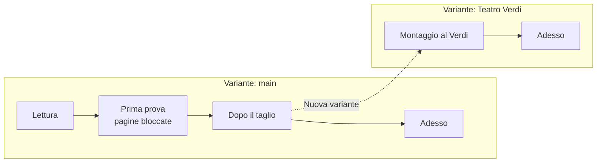

# Revisioni, varianti e pagine bloccate

*Tre risposte alla domanda «che versione è questa?»*

«Che versione?» sono in realtà tre domande, fatte da persone diverse.

- Il regista chiede: *possiamo tornare a com'era martedì?* È una domanda sul **tempo**.
- Il produttore chiede: *questo è il taglio per il festival o la versione intera?* È una domanda sull'**occasione**.
- L'attore chiede: *la mia pagina 14 è ancora la pagina 14?* È una domanda sulla **carta**.

Promptbook ha uno strumento per ciascuna: una revisione, una variante, un blocco dei numeri di pagina. Sono tenuti separati apposta, perché è mescolarli che rende ingestibili le versioni.

## Una revisione è un momento, con un nome, di tutto lo spettacolo

Ogni modifica che fai viene salvata man mano. Questo protegge dal perdere il lavoro; non ti dà niente *a cui* tornare. Una revisione sì: è lo spettacolo com'è nell'istante in cui premi **Salva revisione**, sotto un nome che gli dai tu, come «Prova 12 ottobre» o «Prima del taglio al secondo atto».

Due cose contano.

**Si salva solo quando lo dici tu.** Lo strumento non fa una revisione ogni sera. Una revisione segna un momento che significa qualcosa per la compagnia, e solo tu sai quali sono. Un'abitudine utile: una alla fine di ogni prova, una prima di ogni grossa modifica, una ogni volta che distribuisci carta.

**È tutto lo spettacolo.** Testo, cue, inchiostro, tavole, modelli, impostazioni. Quando premi **Ripristina** su una revisione, torna tutto insieme: i cue numerati com'erano allora, gli schemi disegnati com'erano allora. Non c'è modo di riportare solo il vecchio testo tenendo l'inchiostro di oggi, perché l'inchiostro scritto sulle parole di oggi non avrebbe niente su cui stare.

Nemmeno ripristinare fa perdere qualcosa. Prima di tornare indietro, lo spettacolo com'è adesso viene salvato da solo come revisione, chiamata «Prima di passare a …». Da un ritorno si può sempre tornare.

## Una variante è lo spettacolo come va in scena altrove

Una tournée arriva in un teatro con un impianto più piccolo. Un concorso vuole quaranta minuti, non settanta. Una replica per le scuole salta una scena. Ognuna è lo stesso spettacolo e non lo stesso testo, e ognuna continuerà a cambiare per conto suo.

Una variante è questo: un ramo dello spettacolo con revisioni sue. **Nuova variante** ne apre una a partire dallo spettacolo com'è; da lì in poi scegli in quale variante lavori, e una modifica fatta in una non arriva alle altre.

Quest'ultima frase è il prezzo. Se l'autore corregge una battuta che tutte le varianti hanno, la correzione si fa una volta in ciascuna. Lo strumento non fonde. È stata una scelta: fondere un testo che porta anche cue, inchiostro e pagine bloccate può andare storto in modi che un direttore di scena non dovrebbe dover districare il giorno dello spettacolo. Quindi:

- Fai una variante **tardi**, quando il testo principale si è assestato.
- Fanne una solo per una differenza che **resterà**. Un taglio che stai provando per una settimana è una revisione, non una variante: salvane una prima, prova il taglio, ripristina se non funziona.

## Il blocco dei numeri di pagina è la carta

I numeri di pagina si calcolano dal testo, quindi si muovono quando si muove il testo. Su uno schermo va bene. Una volta che le pagine sono stampate e la compagnia ci ha scritto sopra, no: «riprendiamo dall'inizio della 23» deve voler dire lo stesso foglio per tutti.

Bloccare i numeri di pagina registra dov'era ogni battuta in quel momento. Da lì in poi:

- Una pagina **comincia dove cominciava** sulla carta, qualunque cosa sia stata aggiunta prima.
- Il testo che non ci sta più va in una **pagina inserita**: 12A, 12B, tra la 12 e la 13.
- Una pagina svuotata da un taglio viene **tolta**, e il suo numero non viene più usato.
- Una pagina le cui parole, o i cui a capo, sono diversi dalla carta è **segnata**: «∗ cambiata dopo …» in fondo.

I segni sono il punto. Sono l'elenco dei fogli sbagliati che la gente ha in mano. **Stampa le pagine cambiate** stampa quelli e nient'altro, e la compagnia li sostituisce.

Solo le parole segnano una pagina. Aggiungere o spostare un cue no: le pagine degli attori non mostrano i cue, e nessuno deve ristampare per una modifica alle luci.

Si blocca spuntando **Blocca qui i numeri di pagina** mentre si salva una revisione, così un blocco dice sempre in che momento è stato fatto. Blocca di nuovo a una revisione successiva e quella diventa la carta; le pagine inserite tengono le loro lettere. **Sblocca** torna ai numeri semplici.

## Come stanno insieme le tre cose

- Una **revisione** è un punto su una linea.
- Una **variante** è una linea.
- Un **blocco dei numeri** è una bandierina su un punto, che dice «questo è ciò che è stato stampato». Appartiene alla sua variante: la tournée ha la sua carta.

E due cose che se ne ricavano:

- **Modifiche** confronta due revisioni qualsiasi, o una revisione con lo spettacolo adesso. È l'elenco di ciò che l'autore ha fatto tra due prove e, ristretto a un personaggio, il foglio che dai a quell'attore. Vedi [Dire a ogni attore che cosa è cambiato](../how-to/07-tell-actors-what-changed.md).
- **Il file per gli attori** è il testo dello spettacolo nel momento in cui lo fai. Non sa niente delle revisioni; salvarne una ogni volta che mandi un file è il modo per ricordare che cosa ha la compagnia. Vedi [Il copione in mano agli attori](04-the-cast-script.md).

## Quale usare

| Vuoi | Usa |
|---|---|
| Poter annullare le modifiche della prova di stasera | Una revisione, salvata prima |
| Provare un taglio e forse tenerlo | Una revisione prima; ripristina se no |
| Tenere una versione più corta per un festival, accanto a quella intera | Una variante |
| Distribuire le pagine e tenerne i numeri | Una revisione con la spunta sul blocco |
| Sostituire solo i fogli sbagliati | Il blocco, poi «Stampa le pagine cambiate» |
| Dire ad Anna che cosa è cambiato nella sua parte | Modifiche, mostrate per ANNA |

## Su che cosa si regge, e i suoi limiti

La cronologia è un vero repository git dentro il file spettacolo. Non è una cosa che devi sapere per usarla; vuol dire che non è stato inventato niente, che la cronologia viaggia con il file, e che chi usa git può decomprimere uno spettacolo e leggerlo con gli strumenti di git.

Ne vengono anche i limiti:

- **La cronologia vuole un file spettacolo.** Uno spettacolo tenuto solo nel browser non ne ha. Usa prima «Salva come file spettacolo…».
- **Il file cresce.** Ogni revisione tiene una copia di ciò che è cambiato dall'ultima, e l'inchiostro cambia a ogni tratto. Non viene mai buttato niente.
- **Una revisione non si può rinominare né eliminare**, e nemmeno una variante, dallo strumento.
- **Non si può guardare una vecchia revisione senza andarci.** Per leggere il testo di martedì ripristini martedì (oggi viene tenuto) e poi torni.
- **Non è registrato chi ha salvato una revisione.** Lo spettacolo ha un solo redattore; la cronologia dice quando, non chi.

## Una nota sulle parole

In queste pagine **blocco** da solo è un pezzo di testo: una battuta, un'azione, un titolo. Quando si parla di fissare la carta è sempre scritto «numeri bloccati», «pagine bloccate» o «blocco dei numeri di pagina».
