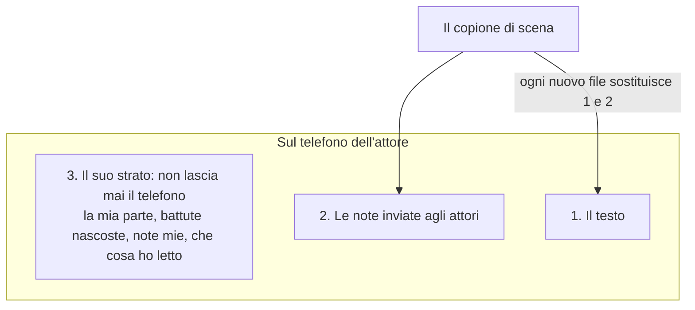

# Il copione in mano agli attori

*Che cosa esce dal copione di scena, che cosa non esce mai, e che cosa resta su un telefono.*

## Due file, apposta

Il copione di scena è un tavolo da lavoro: cue, inchiostro, schemi di movimento, cronologia, una penna. A un attore non serve niente di tutto questo. Gli servono le sue parole, le note per lui, e un modo per studiare la parte in autobus.

Quindi la compagnia riceve un altro strumento: un piccolo lettore, `promptbook-cast.html`, che si apre sul telefono e non può modificare il copione. «Invia agli attori…» scrive una copia di quel lettore con dentro il tuo spettacolo. Un solo file, mandato nel modo in cui la compagnia manda già tutto. Nessuno installa niente e niente passa da un server.

## Tre strati

Ciò che un attore vede sono tre cose sovrapposte, e conviene tenerle distinte, perché ognuna ha un proprietario diverso.

1. **Il testo.** Il copione senza cue, commenti e appunti «da fare». Il frontespizio e i personaggi restano.
2. **Le note che hai inviato.** Ognuna appartiene a una battuta e dice chi l'ha scritta e per chi è.
3. **Lo strato dell'attore.** Quali personaggi sono suoi, se le sue battute sono coperte, le note che ha scritto lui, quali delle tue note ha letto.

Gli strati 1 e 2 sono tuoi. Ogni file che mandi li sostituisce entrambi, interi. Lo strato 3 è suo. Vive sul suo dispositivo, non è mai nel tuo file, e non torna mai a te.

È questa divisione a rendere sicuro mandare un nuovo file. Non stai sovrascrivendo il lavoro di nessuno, perché il loro lavoro non è mai stato in ciò che hai mandato.

## Che cosa non esce mai dal copione di scena

Cue, appunti «da fare», commenti, inchiostro, tavole, cronologia, tempi della modalità spettacolo. Un file per gli attori non può far trapelare il piano luci, e farlo non cambia niente nello spettacolo.

## Le note per gli attori sono cue di un reparto speciale

Non c'è un sistema di note a parte da imparare. In Impostazioni un reparto può avere la spunta **Attori**. Una nota messa sotto quel reparto si scrive esattamente come un cue, su una parola, con un suo testo. Il nome del reparto è chi parla: chiamalo «Regia» e l'attore legge «Regia: più piano qui».

Una nota così è per **chi dice la battuta**, se non dici altro. Su una riga che non dice nessuno (un'azione, un titolo di scena) è per tutti. Puoi nominare altri, o tutti, nel riquadro della nota.

Due conseguenze:

- Una nota appartiene a **tutta la battuta**, non alla parola su cui l'hai messa. L'attore la vede accanto alla battuta.
- Queste note sono elencate in **Rivedi**, sotto «Note per gli attori», e mai nella lista cue. Gli operatori non ricevono note di recitazione.

## Quando arriva un nuovo file

Questa è la parte su cui si è dovuto ragionare. Il testo è cambiato; l'attore ha note sul vecchio testo; che cosa succede?

Il lettore sa che un file appartiene allo stesso spettacolo (per un'identità che il copione di scena dà allo spettacolo, non per il titolo: uno spettacolo rinominato è lo stesso spettacolo) e che è più recente. Poi:

- **Una sua nota su una battuta che non è cambiata** resta su quella battuta.
- **Su una battuta cambiata**, va alla battuta più simile dello stesso personaggio ed è segnalata, finché l'attore non la conferma lì.
- **Su una battuta tagliata**, lascia la pagina ma non viene eliminata: resta sotto Note con le parole su cui era scritta, e si può mettere su un'altra battuta.
- **Una tua nota, invariata**, resta letta se era letta. Una nota che hai riformulato è di nuovo nuova.
- **Le battute diverse** dal file precedente sono segnate sul bordo.

Il file si apre su **Novità**: note da leggere, quante battute sono cambiate e quante sono sue, quali delle sue note vanno riguardate. Un attore che apre il nuovo file sa in dieci secondi se c'è qualcosa che lo riguarda.

Un file **più vecchio** aperto per sbaglio non disfa niente di tutto questo: il lettore dice che è più vecchio e lascia stare lo strato dell'attore.

## La mia parte, e studiare le battute

**La mia parte** elenca ogni nome di chi parla esattamente come lo scrive il copione, con una casella accanto. Un attore spunta i nomi sotto cui parla. `ANNA E MARCO`, `TUTTI`, `CORO` sono nomi come gli altri: lo strumento non indovina chi fa parte di un gruppo, è l'attore a spuntare i gruppi di cui fa parte. È voluto. Chi canta nel coro lo sa la compagnia, cambia con la distribuzione, e non è scritto nel copione.

**Nascondi le mie battute** copre il testo sotto i nomi spuntati e lascia il nome, così la battuta che dà l'attacco si legge e la propria no. Un tocco mostra una battuta; un altro la ricopre.

Una volta spuntata una parte, le note mostrate sono quelle per quella parte e quelle per tutti.

## Che cosa non può fare

Meglio saperlo ora che alla generale:

- **Le note vanno in una sola direzione.** Un attore non può rispondere attraverso il file, e tu non vedi che cosa è stato letto.
- **Un solo file va a tutti.** Una nota per Anna è dentro il file che riceve Marco; lui non la vede sotto «Per me», ma può vederla sotto «Tutti». Non mettere in una nota per gli attori ciò che deve leggere una persona sola.
- **Una nota inviata non si ritira.** Semplicemente il file successivo non ce l'ha.
- **Lo strato dell'attore sta in un browser su un dispositivo.** Un telefono nuovo, un altro browser, o un'app di posta che apre ogni allegato in un visualizzatore chiuso, e il file si apre senza parte e senza note. **Esporta le mie note** sul vecchio dispositivo e aprire quell'esportazione sul nuovo le porta di là, a mano.
- **Le battute cambiate si trovano confrontando battute intere.** Una virgola è una modifica. Una battuta spostata altrove, invariata, non lo è.
- **Non ancora provato su telefoni veri.** È stato verificato in un browser simulato alla larghezza di un telefono. Aprire un allegato `.html` da un'app di chat o di posta su Android e iOS non è stato provato; alcune potrebbero mostrare il file come testo o senza memoria. Provalo con un attore prima di mandarlo a venti.

## La carta c'è ancora

Il file per gli attori non sostituisce le pagine stampate per una compagnia che lavora su carta; le affianca. La carta ha il suo modo di restare aggiornata: i numeri di pagina bloccati e «Stampa le pagine cambiate» ([Revisioni, varianti e pagine bloccate](03-revisions-variants-locks.md)). Molte compagnie useranno entrambi: i fogli in sala prove, il telefono per studiare la parte e leggere le note.
