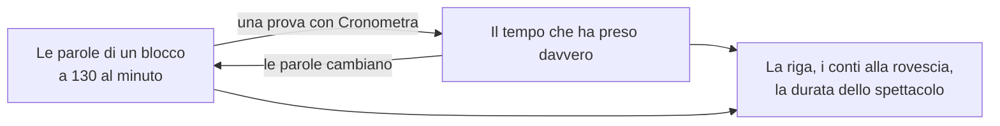

# Un orologio, non un orecchio

*Che cosa sa dello spettacolo la modalità spettacolo, e che cosa bisogna dirle.*

## A che cosa serve

La sera dello spettacolo il copione ha un compito solo: dire al direttore di scena che cosa sta per arrivare, abbastanza presto da poter dire «pronti». Sulla carta lo si fa leggendo avanti con un dito sulla battuta. La modalità spettacolo legge avanti lei: una riga scende lungo il copione, e i cue che sta per raggiungere vengono chiamati, **ATTENZIONE** a due minuti, **PRONTI** a trenta secondi, **VIA** quando li passa.

Rende anche sicuro il copione. In modalità spettacolo non si può cambiare niente: la penna non disegna, un tocco non mette cue, nessun tasto modifica. Una manica sullo schermo durante il secondo atto non può spostare un cue.

## Che cosa non sa

Lo strumento non sente il palco. Non ha microfono e non segue nessuna voce. La riga è un orologio che scorre sul testo: sa quanto *dovrebbe* durare ogni battuta e si muove di conseguenza. Quando un attore fa una pausa, salta una pagina o si prende una risata, la riga non lo sa.

Quindi la riga è giusta in media e sbagliata nel dettaglio, e chi tiene il copione la corregge. Un doppio tocco su una parola dice «lo spettacolo è qui»; la riga va lì. Non è un difetto da aggirare, è il modo in cui la cosa va usata: lo strumento tiene il conto, tu lo tieni onesto. Le chiamate restano tue. Il conto alla rovescia ti dice quando prendere fiato.

## Da dove vengono i tempi

Ogni blocco del copione (una battuta, un'azione) ha un tempo.

All'inizio è una stima: il numero delle sue parole a 130 parole al minuto, con qualcosa in più per un'azione, perché «si battono» sono due parole e due minuti. Una stima così basta per avere le chiamate più o meno giuste e non basta per fidarsi.

La prova la migliora. Con **Cronometra** acceso, ogni volta che fai doppio tocco per dire «lo spettacolo è qui» mentre la riga scorre, il tempo reale passato dal tuo ultimo segno viene conservato e ripartito tra i blocchi in mezzo. Segna spesso e ogni battuta ha il suo tempo; segna una volta per pagina e il tempo della pagina si distribuisce sulle sue battute. Una sequenza muta si può impostare a mano, cinque secondi alla volta.

Dopo una filata cronometrata la riga segue lo spettacolo da vicino, e il conto alla rovescia verso un cue vuol dire qualcosa.

Tre cose impediscono che vada storto:

- **Cronometra è spento ogni volta che entri in modalità spettacolo.** Una sera di spettacolo non cambia mai i tempi per sbaglio.
- **Un tempo appartiene alle parole.** Riscrivi una battuta e il suo tempo è dimenticato; torna alla stima finché non viene cronometrata di nuovo. Una scena riscritta non si porta dietro un tempo vecchio.
- **Le sciocchezze non vengono imparate.** Un segno fatto con la riga ferma, un salto all'indietro, un tratto impossibilmente veloce o lento: spostano la riga e non restano come tempi.

## Il ritmo della serata

Certe sere si va veloci. Il pubblico è freddo, o il protagonista ha un treno da prendere. I tempi non sono sbagliati; è stasera.

Per questo c'è un secondo comando, più piccolo: il ritmo della serata. − e + fanno scorrere la riga un po' più lenta o più veloce di quanto dicono i tempi, solo per questa replica. Torna al 100% la prossima volta che entri in modalità spettacolo. Se correggi la riga per un minuto, il pannello propone il ritmo che le tue correzioni danno, e basta un tocco per prenderlo.

Tieni distinte le due cose. *Cronometra* insegna al copione quanto dura lo spettacolo. *Il ritmo della serata* gli dice come sta andando questa replica.

## Perché la pagina sta ferma

Una pagina che sale lentamente sotto gli occhi si legge male, e dopo un'occhiata al palco non si ritrova più il punto. Quindi la pagina non scorre con la riga. Sta ferma mentre la riga la percorre, e quando la riga è a due terzi, la pagina salta di un terzo.

Puoi scorrere via in qualsiasi momento per guardare altro, o premere una chiamata per vedere dov'è il suo cue. La riga continua a scorrere dov'era. **Torna alla riga** riporta lì.

## Che altro dà l'orologio

Poiché ogni blocco ha un tempo, ce l'ha tutto lo spettacolo: a che punto sei, quanto manca al ritmo di stasera, e a che ora finisce. Una mappa lungo il bordo mostra le scene nelle loro durate vere, con una tacca per ogni cue. Finché il cronometraggio non è fatto sono stime, e lo dicono.

## Quanto fidarsi

Detto chiaramente: tutto questo è stato verificato in un browser simulato, e non è ancora passato per una prova vera con una compagnia vera. Se 130 parole al minuto siano un buon inizio per i tuoi attori, e come sia cronometrare con la penna nell'altra mano, non si sa.

Finché non ti ha fatto una prova o due:

- Usala prima in prova, con la carta accanto.
- Prendi i conti alla rovescia come un invito a guardare, non come la chiamata.
- Fidati del tutto della parte in sola lettura. Quella è semplice, e tiene.

Come si fanno i due lavori: [Cronometrare lo spettacolo in prova](../how-to/10-time-the-show.md) e [Chiamare uno spettacolo](../how-to/11-call-a-show.md).
